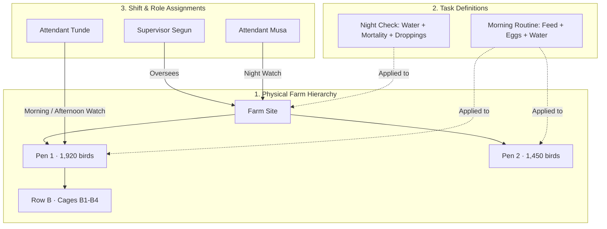

# Specification: Task & Operational Compliance

This document specifies the design, operational rules, lifecycle, and organizational strategy for introducing **Tasks** into LayerBook. Tasks structure daily poultry house operations into scheduled, verifiable routines assigned to shifts and workers—bridging the gap between what a farm owner expects to happen and what actually happens on the pen floor.

---

## 1. Core Concepts

* **Task (Routine Template)**: A recurring operational procedure defined by management (e.g., *Morning Routine*, *Midday Egg Collection*, *Night Check*) that specifies **where** work happens (Pen), **when** it happens (Shift), and **what** specific observations must be recorded (`Feed`, `Eggs`, `Water`, `Mortality`, `Droppings`).
* **Task Instance (Daily Run)**: A concrete occurrence of a Task for a specific pen on a specific day, carrying a live operational status (`Open` $\rightarrow$ `Partial` $\rightarrow$ `Done` $\rightarrow$ `Missed`).
* **Observation Module**: A single domain check inside a pen (such as `Feed Given` or `Water Intake`). When a worker executes a Task, the system restricts their scope to **only** the Observation Modules defined in that Task.
* **Generic Activity (Ad-Hoc Pass)**: An unscheduled observation logged outside of a Task (for example, spotting dead birds in a cage at 1:15 PM). Generic Activities update the farm's daily totals and history but do not carry a schedule or status lifecycle.

---

## 2. Operational & Recording Separation

It is critical to maintain a strict separation between **recording numbers** and **fulfilling operational compliance**:

* **Daily Pen Totals (The Ledger)**: Represents the cumulative physical output and inputs of a pen for the day (total crates harvested, total bags fed, total mortality). Both **Tasks** and **Generic Activities** contribute to Daily Pen Totals.
* **Task Status (The Compliance State)**: Represents whether the farm's scheduled standard of care was upheld on time (`Open` $\rightarrow$ `Partial` $\rightarrow$ `Done` $\rightarrow$ `Missed`).

Recording 30 crates of eggs in Pen 1 updates the pen's **Daily Pen Totals** immediately, but a **Task** (`Morning Routine`) only transitions to `Done` when *every* module required by that Task (e.g., `Feed`, `Eggs`, and `Water`) has been satisfied.

---

## 3. Task Types & Scheduling Patterns

The system supports three types of Task patterns to match how real poultry farms operate:

1. **Daily Shift Routines (Recurring)**:
   * The backbone of the farm (90% of daily execution).
   * Generated automatically every day across shifts (`Morning`, `Afternoon`, `Evening`, `Night`).
   * *Examples*: `Morning Routine` (`Feed`, `Eggs`, `Water`), `Afternoon Routine` (`Feed`, `Eggs`), `Night Check` (`Water`, `Mortality`, `Droppings`).
2. **Periodic & Cycle Tasks (Interval-Based)**:
   * Tasks that recur on weekly, bi-weekly, or flock-age intervals rather than every shift.
   * *Examples*: Weekly bird weight sampling, bi-weekly manure belt clearing, or scheduled vaccination/medication protocols at specific flock weeks.
3. **One-Off Directive Tasks (Intervention)**:
   * Created on demand by a manager, supervisor, or veterinarian in response to an anomaly.
   * *Example*: After a spike in watery droppings in Pen 2, the manager issues a one-off *Midday Hydration & Droppings Check* for Pen 2 for the next 3 days.

---

## 4. Task Lifecycle & Status Mechanics

Every Task Instance progresses through a deterministic status lifecycle during the day:

```
[Scheduled] ──(Shift Window Opens)──> [Open] ──(Some Modules Logged)──> [Partial] ──(All Modules Logged)──> [Done]
                                        │                                  │
                                        └───────(Shift Window Ends)────────┴──> [Missed / Incomplete]
```

### A. Status Definitions
* **`Scheduled`**: Future task whose shift window has not yet started.
* **`Open`**: Active for the current shift; zero required modules have been recorded yet.
* **`Partial`**: The worker has recorded at least one required module (e.g., `Feed Given`), but one or more required modules (e.g., `Water Intake`) are still missing.
* **`Done`**: Every module required by the Task has been recorded.
* **`Missed` / `Incomplete`**: The shift window closed while the Task was still `Open` (`Missed`) or `Partial` (`Incomplete`).

### B. Dynamic Evaluation (Zero Stale Statuses)
Just as overdue invoices are evaluated dynamically against time, a Task's completion state is evaluated deterministically from the observations logged for that pen and shift:
* If a Task requires `Feed` + `Eggs` + `Water`:
  * `0 of 3` logged $\rightarrow$ **`Open`**
  * `1 or 2 of 3` logged $\rightarrow$ **`Partial`**
  * `3 of 3` logged $\rightarrow$ **`Done`**

### C. Cross-Credit Rule (Ad-Hoc to Task Reconciliation)
If an attendant logs `Feed Given` for Pen 1 via an ad-hoc Generic Activity during the `Afternoon` window, that observation automatically satisfies the `Feed` requirement of Pen 1's `Afternoon Routine` Task—preventing double entry while still requiring the attendant to complete the remaining `Eggs` check for the Task to reach `Done`.

---

## 5. Decoupled Pen, Shift & Staff Assignment Strategy

Farms vary widely in how they organize labor. To support small family farms, medium commercial farms, and large multi-site operations without changing the core Task model, **Task Definitions**, **Pen Hierarchy**, and **Staff Assignments** are decoupled:



### Modeling Different Farm Management Styles

#### 1. Dedicated Pen Attendant (House Ownership)
* **Setup**: One attendant ("Tunde") is assigned permanently to `Pen 1` for daytime shifts (`Morning`, `Afternoon`, `Evening`).
* **Resolution**: Tunde is accountable for all daytime Tasks in `Pen 1`. If `Pen 1 · Afternoon Routine` is left `Partial`, accountability resolves directly to Tunde.

#### 2. Specialized Role Crews (Function Ownership)
* **Setup**: On larger farms, one crew handles feeding across all pens (`Pen 1`..`Pen 10`), while a separate crew handles egg collection and grading.
* **Resolution**: Management splits the routines into role-specific Tasks (*Morning Feeding* assigned to the Feed Crew; *Morning Egg Pass* assigned to the Collection Crew).

#### 3. Roaming Night Watch (Shift Ownership)
* **Setup**: During the `Night` shift, a single night attendant covers the entire farm (`Pen 1`, `Pen 2`, `Pen 3`) to check water lines, mortality, and droppings.
* **Resolution**: The `Night Check` Task is assigned to the Night Watch role across all pens.

---

## 6. Phased Evolution Roadmap: What Task Becomes

### Phase 1: Guided Routine Execution & Live Shift Visibility (Current Foundation)
* **Objective**: Replace passive open-ended logging with pre-filtered, stateful Tasks per pen and shift.
* **Operational Flow**:
  1. Each pen has a daily set of shift Tasks (`Morning Routine`, `Afternoon Routine`, `Evening Routine`, `Night Check`).
  2. When a worker selects a Task, the system filters out unrelated modules and presents **only** the checks required by that Task.
  3. As modules are logged, the Task transitions from `Open` $\rightarrow$ `Partial` $\rightarrow$ `Done`, and the pen's daily totals and activity history update atomically.

### Phase 2: Custom SOP Builder, Shift Cutoffs & Watch Attribution
* **Objective**: Let farm managers configure custom Task templates from the Owner Console and tie every Task Instance to a specific shift cutoff time and worker on watch.
* **Capabilities**:
  1. **Custom Task Templates**: Managers create or edit routines per pen (e.g., adding a *Midday Egg Pass* for peak-lay flocks in Pen 3 while keeping Pen 1 on two passes).
  2. **Shift Cutoff Windows**: Attach time boundaries to shifts (e.g., `Morning Routine` due by `10:00 AM`). Any Task still `Open` or `Partial` after cutoff is automatically flagged as **`Overdue` / `Missed`** for the supervisor.
  3. **Watch Attribution**: Stamp every completed, partial, or missed Task with the assigned attendant on duty—eliminating shift-handover finger-pointing.

### Phase 3: Root-Cause Forensics & Biological Lag Correlation
* **Objective**: Connect today's production or health anomalies backward in time to the upstream Task breakdowns that caused them.
* **Why This Matters**: In layer farming, biological outcomes lag behind husbandry failures by **24 to 72 hours**. A 20% drop in egg crates or a spike in cracked shells on Thursday is almost never caused by Thursday's events—it is caused by a missed water check on Tuesday night or a delayed feeding pass on Wednesday afternoon.
* **Analytical Capability**:
  * When a pen flags an anomaly (crate drop $> 10\%$, cracked egg spike, or localized cage mortality), LayerBook queries the preceding 72 hours of Task history for that pen:
    ```text
    [Tue 9:00 PM · T-36h]  Pen 2 · Night Check        → MISSED (Water & Droppings not checked — Night Watch)
    [Wed 8:30 AM · T-24h]  Pen 2 · Morning Routine    → PARTIAL (Feed logged; Water Intake skipped — Attendant A)
    [Wed 2:10 PM · T-18h]  Pen 2 · Ad-Hoc Pass        → INCIDENT (Watery droppings in Row A)
    [Thu 9:00 AM · T-0h]   Pen 2 · Egg Harvest        → OUTCOME (Crate output down 22%, cracked shells up 3x)
    ```
  * Instead of reporting a mysterious production drop, the system surfaces the exact chain of custody—identifying *what* was skipped, *when*, and *under whose watch*.

### Phase 4: Staff Reliability Scoring & Adaptive Vet Protocols
* **Objective**: Turn longitudinal Task compliance data into workforce performance metrics and dynamic flock-health interventions.
* **Capabilities**:
  1. **Attendant Reliability Profiles**: Measure each worker's on-time Task completion rate, `Partial`-to-`Done` follow-through, and early-incident reporting accuracy over 30/60/90-day cohorts—allowing owners to tie bonuses and promotions to objective discipline.
  2. **Adaptive Vet Tasks**: When an incident is logged in a specific cage or row (e.g., bloody droppings in `Pen 2 · Row B`), the system or veterinarian can automatically inject a temporary 5-day *Isolation & Medication Task* into `Pen 2`'s schedule until the anomaly clears.
